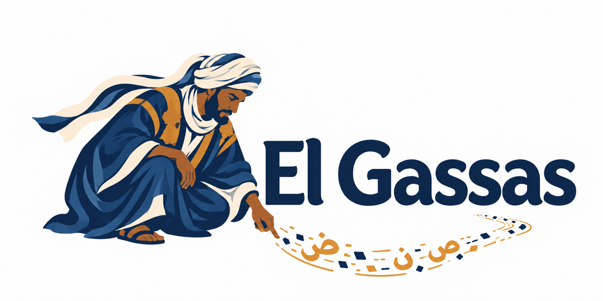
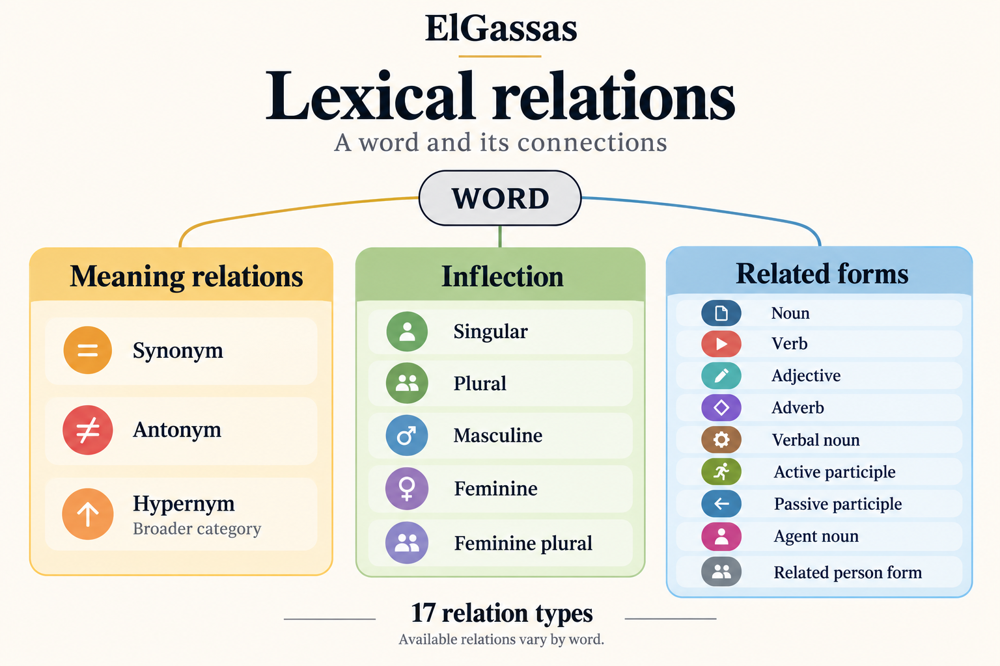

<p align="center">
  
</p>

# El Gassas: Tracing Hassaniya Knowledge in Language Models

A benchmark for Hassaniya understanding and Mauritanian cultural knowledge.

El Gassas examines how well models understand Hassaniya in the context of Mauritanian life and culture. It brings together vocabulary, word relationships, proverbs, and riddles to explore both linguistic knowledge and the cultural knowledge needed to interpret the language.

Its purpose goes beyond translating words into Arabic or English. It asks what a model already knows about Hassaniya words, how deeply it understands their relationships and forms, and whether it can interpret expressions in their Mauritanian social and cultural contexts. Mauritanian social life, traditional objects, shared imagery, and cultural expectations are central to this understanding.

The benchmark currently contains **2,521 entries across five datasets**.

For further reading and analysis of the results, see [KhaimaLabs](https://khaimalabs.github.io/index.html).

## The collection

| Dataset | What it covers | Entries |
| --- | --- | ---: |
| [Arabic vocabulary](elgassas_vocabulary_mcqa_ar.jsonl) | Word recognition without context, using Arabic questions and options | 1,022 |
| [English vocabulary](elgassas_vocabulary_mcqa_en.jsonl) | Word recognition without context, using English questions and options | 1,000 |
| [Lexical relations](elgassas_lexical_relations.jsonl) | Depth of word knowledge through semantic relationships and grammatical forms | 236 |
| [Proverbs](elgassas_proverbs.jsonl) | Hassaniya sayings and their intended uses | 100 |
| [Riddles](elgassas_riddles.jsonl) | Hassaniya riddles and their solutions | 163 |
| **Total** | | **2,521** |

The counts include related words, expressions, and wording variants.

## Repository layout

| Path | Purpose |
| --- | --- |
| `elgassas_*.jsonl` | The five benchmark datasets |
| `assets/` | Images used by this README |

## Arabic vocabulary

This task probes the breadth of a model’s internalized Hassaniya vocabulary. It presents an isolated word or expression with four possible meanings written in Arabic, without a sentence or passage providing contextual clues.

The aim is to assess whether the model already recognizes the word’s meaning. A surrounding sentence could help it infer the meaning of an unfamiliar word. Here, the question focuses on the vocabulary knowledge the model has already acquired.

**Example entry**

```json
{
  "id": "499",
  "term": "حِگّْ",
  "meaning_arabic": "ولد الناقة إذا أكمل ثلاث سنوات ودخل في السنة الرابعة",
  "question": "ماذا تعني كلمة «حِگّْ» في الحسانية؟",
  "options": [
    "ولد الناقة المفطوم بعد سنة ونصف إذا أنتجت أمه بعده",
    "ولد الناقة بين سنتين وثلاث عند بداية استقلاله عن أمه",
    "ولد الناقة إذا أكمل ثلاث سنوات ودخل في السنة الرابعة",
    "ولد الناقة إذا قارب خمس سنوات ودخل فيها واشتد للركوب"
  ],
  "answer_index": 2
}
```

## English vocabulary

This task probes recognition of isolated Hassaniya words using English questions and four answer options. No sentence or passage is supplied to help infer the meaning.

It asks whether a model can draw on its existing Hassaniya vocabulary knowledge to recognize a word and identify its meaning in English.

**Example entry**

```json
{
  "id": "960",
  "term": "المِهْرَاسْ",
  "meaning_arabic": "وعاء خشبي أسطواني صلب يُدق فيه الحبوب واللحم بالرزامة.",
  "question": "What does the Hassaniya word “المِهْرَاسْ” mean?",
  "options": [
    "A solid cylindrical wooden vessel in which flour and water are kneaded with the hands",
    "A solid cylindrical wooden vessel in which milk and butter are churned with a staff",
    "A solid cylindrical wooden vessel in which tea and sugar are mixed with a spoon",
    "A solid cylindrical wooden vessel in which grain and meat are pounded with a pestle"
  ],
  "answer_index": 3
}
```

## Lexical relations

This task probes the depth and structure of a model’s internalized Hassaniya lexical knowledge. Given a word, it asks the model to identify related meanings and grammatical forms, including synonyms, antonyms, broader categories, singular and plural forms, masculine and feminine forms, and derivations such as verbal nouns and participles.

The aim is to examine how well the model knows a word as part of a connected vocabulary and grammatical system, extending beyond recognition of a single definition.

Some entries include a brief sense label to specify which meaning of the word is intended. The available relations vary from one entry to another.



**Example entry**

```json
{
  "id": "051",
  "term": "يِجْلِبْ",
  "part_of_speech": "verb",
  "meaning_arabic": "يسوق الماشية إلى المدينة لبيعها وشراء الميرة والمؤونة",
  "meaning_english": "To take livestock to town to sell and buy provisions.",
  "sense_context": "في سوق الماشية للبيع",
  "forms": {
    "verbal_noun": [
      "اجْلِيبْ",
      "اِجْلِيبْ"
    ],
    "agent_noun": [
      "جَلَّابْ"
    ]
  },
  "available_relations": [
    "verbal_noun",
    "agent_noun"
  ]
}
```

## Proverb understanding

This task focuses on what a Hassaniya saying conveys and the Mauritanian social situations in which someone would use it. Intended use descriptions, written in Arabic or Hassaniya, explain the situation or purpose associated with each proverb.

Understanding a proverb requires recognizing what a speaker intends to communicate, such as advice, criticism, reassurance, or a judgment about someone’s behavior. Through these sayings, the task explores understanding of social expectations, relationships, and values expressed in Mauritanian life. Recognizing a broad theme alone may miss the particular point of the saying.

**Example entry**

```json
{
  "id": "051",
  "proverb": "الجِّغْمَه اِللِّي حَسْدِتْ أَگَرْطُوعْ:",
  "intended_use": "يضرب هذا المثل لمن يُراد له الأمرُ العظيمُ، ولكنْ لحماقته يستعجلُ كي ينال القليلَ فيحرمه من الأمر العظيم."
}
```

## Riddle solving

This task combines reasoning from Hassaniya clues with familiarity with objects, living things, and practices referenced in Mauritanian everyday life. A solution may depend on recognizing a traditional object, understanding an image familiar within the culture, or connecting a description to its intended meaning.

Solutions may include a Hassaniya name, an Arabic equivalent, or a short clarification of the answer.

**Example entry**

```json
{
  "id": "077",
  "riddle": "تعشر من ذروته وتولد من كلوته",
  "answer": "الرحى"
}
```

## Evaluation

For Arabic and English vocabulary MCQA, use **exact-match accuracy**: score 1
when the predicted option index equals `answer_index` (zero-based), and 0
otherwise. Accuracy is the proportion of correct predictions.
